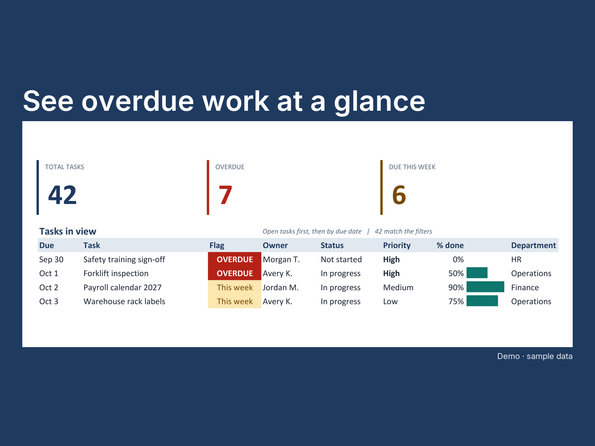

# Excel work tracker with a live dashboard

One Excel workbook, no macros: people type tasks into a table and the Dashboard sheet keeps itself up to date.



## What it does

- Turns a plain task table into a dashboard: five totals (Total, Overdue, Due this week, In progress, Done), the task list with open work first, the next five due dates, a "This Week's Focus" box and progress by owner.
- Flags itself every day: an overdue task turns red and says OVERDUE; one due this week turns amber and says so.
- Three dropdown filters (Owner, Status, Year); pick one and the whole page follows.
- New rows are picked up with no formula edits. Works in Excel 2010 and later, including Microsoft 365. No macros, no add-ins.

## Demo

**Every task, name and department in this repository is invented.** The demo takes two minutes and needs only Excel:

1. Open `Work Tracker Demo.xlsx` and look at the **Dashboard** sheet.
2. Change the Owner, Status or Year cell at the top; choose `(All)` to clear.
3. On the **Tasks** sheet, type a task in the first empty row under the table, then go back to the Dashboard.

The flags depend on today's date, and the sample due dates were set on the day the workbook was built (last built 2026-11-04), so over time more sample tasks become overdue. To rebuild it with fresh dates (Windows with Excel installed; Excel runs hidden and your own Excel windows are not touched):

```powershell
python -m venv .venv
.\.venv\Scripts\python.exe -m pip install -r requirements.txt
.\.venv\Scripts\python.exe build_workbook.py
```

## How it's built

- **Plain Excel formulas, no code in the workbook.** The logic sits in named formulas (`InScope`, `CondOverdue`, `SortKey` and so on); each dashboard cell is one short formula such as `=SUMPRODUCT(CondOverdue)`. Nothing newer than `AGGREGATE` (Excel 2010), so no dynamic arrays and no macros.
- **Built from a script, so nothing drifts.** `build_workbook.py` drives Excel (pywin32) to write the workbook; the test and the screenshots are built from the same source, so a change to the layout is made once.
- **Clean files.** After Excel saves, the script rewrites the file's properties (author "AZG Engineering"), and removes the stored folder path and printer settings. Nothing about the PC that built it is left in the file.
- **No credentials, no network.** Everything runs on the local machine and installs into this folder only.

The named formulas, how to change the lists and statuses, the dependency licences and the screenshot tooling are in [`docs/DETAILS.md`](docs/DETAILS.md).

## Tests

```powershell
.\.venv\Scripts\python.exe tests\test_workbook.py
```

The test opens the workbook read-only in Excel, recomputes every total and every list line in Python under several filters, adds test rows in memory (a new owner, an overdue task, a row typed under the table) and checks the dashboard follows, then closes without saving and confirms the file on disk is unchanged. Current run (2026-11-04): **87 checks, all passed.**

## Built by AZG Engineering

Built by [AZG Engineering](https://azgengineering.com), small automations for small businesses and public-sector teams.

## Licence

Copyright © 2026 Azimuth Group LLC. All rights reserved. Published as a work sample; no licence to reuse it is granted. The Inter font in `tools\fonts\` is under the SIL Open Font License 1.1 (`tools\fonts\OFL.txt`).
